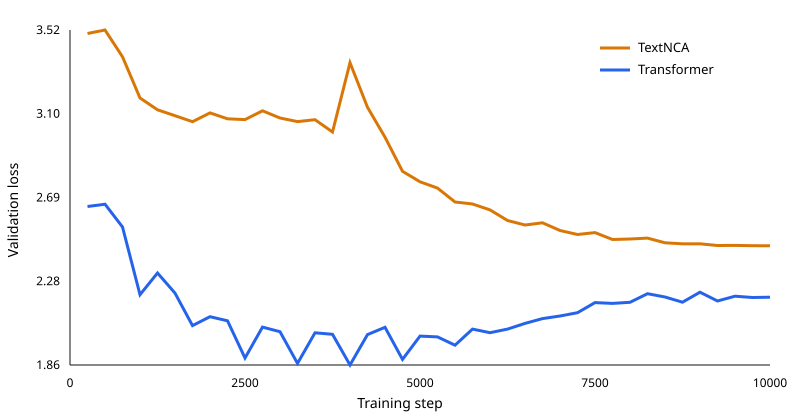

# V1 TextNCA comparison

## Conclusion

**TextNCA loses this V1 comparison.** At the fixed 10,000-step budget, the matched Transformer achieved lower validation and test loss and finished training about 3.28× faster. TextNCA produced a valid serialized prefix more often, but neither model completed a work or preserved held-out speaker identities, and TextNCA showed severe cross-prompt output collapse.

This is a result about this single-seed, 27M-parameter, 19-play experiment—not a claim that TextNCA is universally inferior.



## Controlled comparison

- Training commit: `7e4ecad7071f2ac4ea2bb99c520aac7291333713`
- Run: `v1-7e4ecad`
- Corpus SHA-256: `7fcb04f62766b4e7ef91fc49ce803a59e78dfcf56eb8a6e61c1c884ac7e98970`
- Seen tokens per model: 20,474,330
- Parameters: TextNCA 27,353,920; Transformer 27,179,200 (0.643% difference)
- Shared seed: 123
- Shared context: 512 tokens

## Teacher-forced results

| Metric | TextNCA | Transformer |
|---|---:|---:|
| Final train loss | 2.3649 | 0.9446 |
| Final validation loss | 2.4510 | 2.1963 |
| Best validation loss (step) | 2.4510 (10,000) | 1.8607 (4,000) |
| Test loss | 2.4966 | 2.3095 |
| Test perplexity | 12.141 | 10.069 |
| End-to-end runtime | 58.2 min | 17.7 min |
| Test throughput | 19,717 tok/s | 78,008 tok/s |

TextNCA's final test loss was 8.1% higher and its test perplexity was 20.6% higher. The Transformer reached its best validation checkpoint at step 4,000 and then overfit, while TextNCA continued improving through step 10,000. The equal-budget headline uses the predeclared final checkpoints rather than selecting a post-hoc checkpoint.

## Held-out generation

The generation manifest was fixed before inspecting outputs: early, middle, and late completed-turn boundaries from each of the three held-out plays; identical token prompts, seed, temperature, and 256-token cap for both models. Long prompts use the canonical full prefix for parsing while the model receives its final 512-token context window.

| Macro-average across held-out works | TextNCA | Transformer |
|---|---:|---:|
| Prefix-valid continuation rate | 0.778 | 0.556 |
| Complete serialized work rate | 0.000 | 0.000 |
| Length-censored rate | 0.778 | 0.556 |
| Turn completion rate | 0.417 | 0.509 |
| Allowed-speaker rate | 0.000 | 0.000 |
| Token repeated-trigram rate | 0.200 | 0.194 |
| Character repeated-trigram rate | 0.140 | 0.081 |
| Word repeated-trigram rate | 0.000 | 0.000 |
| Exact unique-continuation rate | 0.556 | 1.000 |
| Cross-work character-trigram similarity | 0.890 | 0.187 |

A fixed-length output that remains a valid grammar prefix is reported as censored, not malformed. Speaker consistency counts only speaker fields reached through valid grammar and checks them against the prompted work rather than the full corpus. TextNCA's 0.778 prefix-valid rate is a limited structural advantage over the Transformer's 0.556, but its outputs were only 5/9 exactly unique and had 0.890 mean cross-work character-trigram similarity, versus 9/9 and 0.187 for the Transformer. The visible samples show this prompt-insensitive collapse.

## Predeclared representative samples

These are the early-boundary samples for every held-out work and both models. They were not selected for quality.

### Tickless Time — v1-textnca

Prompt: `gutenberg-59432-glaspell-plays::Tickless Time::early`; seed 123.

```text
<TURN><SPEAKER>MAKNOI<TEXT>A noel tone’s at wi antomesy, s I hhe ikl l tiwor, s b sreradit, you in nok s he ner yhon as in tomtt ty yothon m is thewi do e fe me as yanir at s te astherpe amatth m yothe tor gothe.<TURN_END><TURN><SPEAKER>HAHDA<DIRECTION>The sere you the in f and sa a fooouler s thetathon
```

### The Cherry Orchard — v1-textnca

Prompt: `gutenberg-7986-chekhov-second-series::The Cherry Orchard::early`; seed 123.

```text
<TURN><SPEAKER>MHONOID<TEXT>Nhoul ty listor t wi antomesy, s I hhe ikl l tiwor, s b sreradit, you in nok s he ner yhon as in tomtt ty yothon m is thewi do e fe me as yanir at s te astherpe amatth m yothe tor gothe.<TURN_END><TURN><SPEAKER>HAHDA<DIRECTION>The sere you the in f and sa a fooouler s thetathon
```

### The Importance of Being Earnest — v1-textnca

Prompt: `gutenberg-844-importance-of-being-earnest::The Importance of Being Earnest::early`; seed 123.

```text
<TURN><SPEAKER>MHONOI<TEXT>A ngel tone’s at wi antome..<ITEM_END><TEXT>Hond... ik’s iwor, s b sreradit, you in nok s he ner yhon the is amtthny yothon m is thewi do e fe me as yanir at s te astherpe amatth m yothe tor gothe.<TURN_END><TURN><SPEAKER>HAHDA<DIRECTION>The sere you the in f and sa a fooouler s thetathon
```

### Tickless Time — v1-transformer

Prompt: `gutenberg-59432-glaspell-plays::Tickless Time::early`; seed 123.

```text
<TURN><SPEAKER>MASHA<TEXT>Or not be this in then I thought door.<TURN_END><TURN><SPEAKER>HELMER<TEXT>Awn’t like a girl, or you or she shore all the come to signAPHALLIE Mrs own do wife dror hall! One so good to poor and the stair, are the gently characted out it with I amust, a from threally thing
```

### The Cherry Orchard — v1-transformer

Prompt: `gutenberg-7986-chekhov-second-series::The Cherry Orchard::early`; seed 123.

```text
<TURN><SPEAKER>MARGARET<TEXT>Oh, CRAIG ans, things?<TURN_END><TURN><SPEAKER>BESSIE<TEXT>I have know when the band a did, you know what where your be in the try were your now were drespected appy?<TURN_END><TURN><SPEAKER>BORTSOV-- has appearson. Then To tree’s been for the room the no me such at faight of law the to has
```

### The Importance of Being Earnest — v1-transformer

Prompt: `gutenberg-844-importance-of-being-earnest::The Importance of Being Earnest::early`; seed 123.

```text
<TURN><SPEAKER>MARGARET<TEXT>Oh, Craig.<TURN_END><TURN><SPEAKER>OLGA<TEXT>I didn’t leave you know the trift? I said tricold, thought the lays, no, it is, they’ll say now, and do simpleasand all of taking at tradied the from for Rangrant.<TURN_END><TURN><SPEAKER>HELMER<TEXT>All mone is traig? I am!<TURN_END><TURN><SPEAKER>HELMER<DIRECTION>T�IN sha conting
```

## Limitations

- One training seed and one generation seed.
- Only 19 plays overall and three held-out test works.
- Near-parameter matching, not exact matching: TextNCA has 0.643% more parameters.
- No architecture or optimizer ablations.
- Teacher-forced loss does not measure human preference or long-range dramatic coherence.
- Generation statistics are descriptive paired probes, not population-level significance claims.
- Manifest token counts include the first stream token; next-token evaluation counts one fewer target token per split.

## Reproduction

Rebuild the corpus, restore the recorded run checkpoints, then run:

```bash
uv run ncm-v1-report --run-root data/runs/v1-7e4ecad --output-dir reports/v1
```

`results.json` contains the prompt manifest, checkpoint hashes, raw sample records, metrics, environment, and exact protocol used to render this report.
