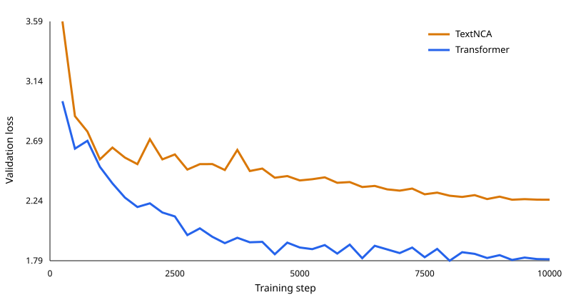

# V2 TextNCA comparison

## Conclusion

**The Transformer wins V2, and the result supports stopping further TextNCA investment in this project.** At the fixed 10,000-step budget, the Transformer achieved lower held-out loss, trained 3.30× faster, and was no worse on either exact continuation diversity or cross-work collapse.

**Decision: Stop TextNCA investment.** The predeclared rule is: Stop further TextNCA investment when it loses on held-out loss and training speed and shows no advantage on exact continuation diversity or cross-work collapse. All four stop criteria evaluated to `true`. Preserve the implementation and reports as a negative result; direct future modeling work to the matched Transformer baseline rather than another TextNCA training round.

Corpus V2 improved both models' teacher-forced loss, but the Transformer improved more: TextNCA 9.5% versus Transformer 21.5%.

This remains a single-seed, approximately 27M-parameter comparison, not a universal claim about every neural cellular automaton architecture.



## Controlled comparison

- Training commit: `d8cbe61523f2627cb786ab1d7d19d0fbc04e5a19`
- Run: `v2-d8cbe61`
- Corpus SHA-256: `d2126f5d958e3190a708f7a502259196d8d9971df4935e33e53c388e1ee9a7c5`
- Corpus: 30 works; 4 held-out test works
- Seen tokens per model: 20,475,138
- Parameters: TextNCA 27,353,920; Transformer 27,179,200 (0.643% difference)
- Shared seed: 123
- Shared context: 512 tokens

## Teacher-forced results

| Metric | TextNCA | Transformer |
|---|---:|---:|
| Final train loss | 2.2232 | 1.2630 |
| Final validation loss | 2.2456 | 1.7969 |
| Best validation loss (step) | 2.2454 (9,250) | 1.7863 (8,000) |
| Test loss | 2.2584 | 1.8131 |
| Test perplexity | 9.568 | 6.129 |
| End-to-end runtime | 69.5 min | 21.1 min |
| Test throughput | 21,197 tok/s | 76,943 tok/s |

TextNCA's final test loss was 24.6% higher. The equal-budget comparison uses the predeclared final checkpoints rather than selecting a post-hoc checkpoint.

## Held-out generation

The prompt manifest was fixed before inspecting output: early, middle, and late completed-turn boundaries from every held-out test work, with identical token prompts, generation seed, temperature, length cap, and EOS policy for both models.

| Macro-average across held-out works | TextNCA | Transformer |
|---|---:|---:|
| Prefix-valid continuation rate | 0.917 | 0.667 |
| Complete serialized work rate | 0.000 | 0.000 |
| Length-censored rate | 0.917 | 0.667 |
| Turn completion rate | 0.375 | 0.469 |
| Speaker-field format rate | 1.000 | 0.917 |
| Allowed-speaker rate | 0.000 | 0.000 |
| Multi-speaker sample rate | 0.750 | 0.667 |
| Speaker transition rate | 1.000 | 1.000 |
| Token repeated-trigram rate | 0.178 | 0.192 |
| Character repeated-trigram rate | 0.000 | 0.053 |
| Word repeated-trigram rate | 0.000 | 0.000 |
| Exact unique-continuation rate | 0.500 | 1.000 |
| Cross-work character-trigram similarity | 0.737 | 0.215 |

A fixed-length output that remains a valid grammar prefix is censored rather than malformed. Speaker consistency checks only grammar-valid speaker fields against the prompted work. Cross-prompt exact uniqueness and character-trigram similarity distinguish within-sample repetition from prompt-insensitive collapse.

TextNCA retained a limited serialization advantage (0.917 prefix-valid and 1.000 speaker-field formatting), while the Transformer completed turns more often (0.469 versus 0.375). Neither model generated an allowed held-out speaker or a complete serialized work. TextNCA also had lower within-sample token and character repeated-trigram rates; both models had zero word repeated-trigram rate. Those narrow advantages do not offset TextNCA's 0.500 unique-continuation rate and 0.737 cross-work similarity.

## V1 to V2

| Change | TextNCA | Transformer |
|---|---:|---:|
| Test loss | -9.5% | -21.5% |
| Exact unique-continuation rate | -0.056 | +0.000 |
| Cross-work similarity | -0.153 | +0.029 |

Negative loss and cross-work-similarity changes are improvements; positive uniqueness changes are improvements.

## Predeclared representative samples

These are the early-boundary samples for every held-out work and both models. They were not selected for quality.

### Beyond the Horizon — v2-textnca

Prompt: `gutenberg-58569-beyond-the-horizon::Beyond the Horizon::early`; seed 123.

```text
<TURN><SPEAKER>MADON<TEXT>Dit'sel to list! The no stome..<TURN_END><TURN><SPEAKER>WISSEL<DIRECTION>Hel lomice._<ITEM_END><TEXT>I’s as it, you if nok sang noo your ast is a theny you ou mand thewird  eifthe ow in alout. I t I you you arangh t you thit. We neveencks, cutherer ay hit whis feand if a foooule-t ma to Muse
```

### The Importance of Being Earnest — v2-textnca

Prompt: `gutenberg-844-importance-of-being-earnest::The Importance of Being Earnest::early`; seed 123.

```text
<TURN><SPEAKER>MADANE<TEXT>A noel tone’s at with that you to the ike llince ay ul sunase t, you if nok shet noo your thild mangteny youre amend thewith  elis meow ay as hat sit I you you andous t yo---2�t romy tou nof pecutl serndous the is feand if a fooouler shat that w
```

### An Ideal Husband — v2-textnca

Prompt: `gutenberg-885-an-ideal-husband::An Ideal Husband::early`; seed 123.

```text
<TURN><SPEAKER>MAKAN<TEXT>Dit't wat teast! Thay ay to I you Whe cof knoury w this be realdit, you if nok shee nooky lind alis a theny you ou mand thewird  eifthe ow in alout. I t I you you arangh t you thit. We neveencks, cutherer ay hit whis feand if a foooule-t ma to Muse
```

### Riders to the Sea — v2-textnca

Prompt: `gutenberg-994-riders-to-the-sea::Riders to the Sea::early`; seed 123.

```text
<TURN><SPEAKER>MAKON<TEXT>Dit'sel to list! The no stome..<TURN_END><TURN><SPEAKER>WISSEL<DIRECTION>Hel lomice._<ITEM_END><TEXT>I’s as it, you if nok sang noo your ast is a theny you ou mand thewird  eifthe ow in alout. I t I you you arangh t you thit. We neveencks, cutherer ay hit whis feand if a foooule-t ma to Muse
```

### Beyond the Horizon — v2-transformer

Prompt: `gutenberg-58569-beyond-the-horizon::Beyond the Horizon::early`; seed 123.

```text
<TURN><SPEAKER>MADGO<TEXT>Didn’t you’ve got the laugh, sir.... in all two give. I said things.<TURN_END><TURN><SPEAKER>STER<DIRECTION>She scared the rightently.<ITEM_END><DIRECTION>Droposed is her her  eyes after and chair rights thround at a moment, to reman age comples are of the bright fears and the out of man the co
```

### The Importance of Being Earnest — v2-transformer

Prompt: `gutenberg-844-importance-of-being-earnest::The Importance of Being Earnest::early`; seed 123.

```text
<TURN><SPEAKER>MADGE<TEXT>Didn’t you’ve think it.<TURN_END><TURN><SPEAKER>LUBOV<TEXT>It’s long in the flowering thing in. Something do your dealistention the bout there. He do wife me a wall. Oh, sir.<TURN_END><TURN><SPEAKER>POPOV<TEXT>You our me.<TURN_END><TURN><SPEAKER>MARROMso head, course, let’s this wouldn’t see me on tell make the w
```

### An Ideal Husband — v2-transformer

Prompt: `gutenberg-885-an-ideal-husband::An Ideal Husband::early`; seed 123.

```text
<TURN><SPEAKER>MADGE<TEXT>Didn’t you story.<TURN_END><TURN><SPEAKER>FALDER<TEXT>The donxt..<TURN_END><TURN><SPEAKER>MRS. PATRICK<DIRECTION>Kisses him, room, soon<ITEM_END><DIRECTION>She sea little and somethings.<ITEM_END><TEXT>I don’t can do wife me a way is abour. I say, and manage; you a times the gentlemen, listen the bright fear!<TURN_END><TURN><SPEAKER>MERCHUT gets out on the
```

### Riders to the Sea — v2-transformer

Prompt: `gutenberg-994-riders-to-the-sea::Riders to the Sea::early`; seed 123.

```text
<TURN><SPEAKER>MASHIN<TEXT>At out to little the things! Let to his in all two my from to him, you know, and go away, in a little they are on the right the wife me a wall. I do it worth--and man stand the tROME<TEXT>Oh, Mr. Why could me a shall his fear!<TURN_END><TURN><SPEAKER>ELOPAKHIN<TEXT>Oh! I contry,
```

## Limitations

- One training seed and one generation seed.
- 30 plays overall and 4 held-out test works.
- Near-parameter matching, not exact matching: TextNCA has 0.643% more parameters.
- No architecture or optimizer ablations.
- Teacher-forced loss does not measure human preference or long-range dramatic coherence.
- Generation statistics are descriptive paired probes, not population-level significance claims.

## Reproduction

```bash
uv run ncm-v2-report --run-root data/runs/v2-d8cbe61 --v1-results reports/v1/results.json --output-dir reports/v2
```

`results.json` contains the prompt manifest, checkpoint hashes, raw sample records, metrics, V1 deltas, decision rule, environment, and exact protocol used to render this report.
